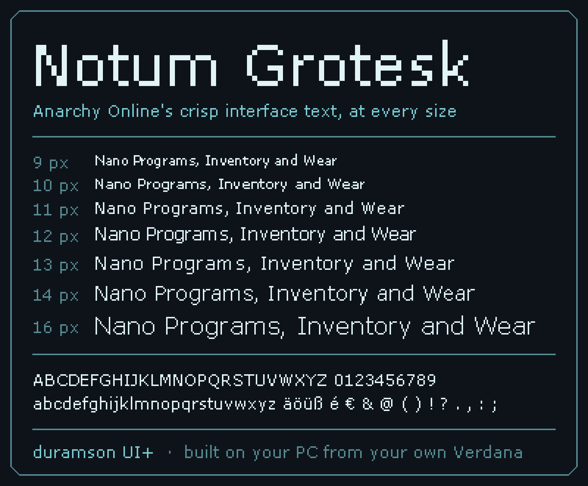

# duramson UI+ for Spiritech

Spiritech, Project Rubi-Ka's new client, brings Anarchy Online to today's computers. UI+ brings back the look of
the original client's interface: window frames built to its measurements, windows laid out as it laid them out,
and its crisp pixel text. It fixes flaws in Spiritech's bundled UI on the way, and adds a few things of its own.


## First pass, window by window

One window at a time gets the original client's look. 100 % means its first pass is done, not that it's finished
for good.

| Window | Progress | |
| --- | --- | --- |
| Nano Programs | `▰▰▰▰▰▰▰▰▰▰` 100 % | Done. The list view gets a second round later. |
| NCU | `▰▰▰▰▰▰▰▰▰▰` 100 % | Done. |
| Inventory | `▱▱▱▱▱▱▱▱▱▱` 0 % | Next: the inventory, bags and banks. |
| Wear | `▱▱▱▱▱▱▱▱▱▱` 0 % | After the Inventory. |

### Elements

Pieces many windows share. Each gets the original client's look once, for every window that shows it.

| Element | Progress | |
| --- | --- | --- |
| Window frame | `▰▰▰▰▰▰▰▰▰▰` 100 % | Done. |
| Scroll bar | `▰▰▰▰▰▰▰▰▱▱` 80 % | In the NCU, Nano Programs and Inventory windows: the original client's own pictures, smooth arrows, placed as there. Other windows' lists and a less stretched bar picture still to come. |

## What works now

| | What it does | How to turn it on |
| --- | --- | --- |
| **Window frame** | Every window's frame, title tab, icon, pin and close button at the original client's sizes, distances and opacity, measured from pictures of its windows. | Nothing to do: it shows from the next character login. |
| **Inventory** | The inventory, bags and banks with the original client's scroll bar, without the tooltips that only repeated their search field and slot count, and the count as just "24 / 30". | Once: Options → Interface & HUD → UI packages, set Inventory containers to `External [duramson.inventory] — UI+`, then log the character in again. |
| **Nano Programs** | School buttons, tiles and search as the original client draws them, or a new School Tabs layout. | Once: Options → Interface & HUD → UI packages, set Nano Programs to `External [duramson.nano] — UI+`, then log the character in again. The window's menu (the i icon) switches between the two layouts. |
| **NCU** | Slots, their spacing and the margins as in the original client's NCU window. | Nothing to do: it shows from the next character login. |
| **Scroll bar** | The original client's scroll bar, from its own pictures: smooth arrows, a pixel clear of the frame's lines, 3 pixels from the bar. In the NCU, Nano Programs and Inventory windows so far. | Comes with those windows. |
| **Tooltips** | Tooltips wait until the pointer has rested on a button or slot for a second and a half, a little longer than the original client, instead of popping up the moment it passes: on the shortcut bars, in grids and lists, on the health and nano bars. The item tooltips in the inventory, bags, bank and Wear window and those of the client's own windows (Options) still show at once: the client draws them itself. | Nothing to do: it works from the next character login. |
| **Notum Grotesk** | UI+'s own font: a modern, scalable take on the pixelated Verdana the original client draws its interface with, made on your computer ([more below](#notum-grotesk)). Notum Grotesk 200 is the same for Retina screens and 200 % scaling. | Say yes when the installer asks to generate it (only `install.py` so far), then pick Notum Grotesk as the interface font in Options (type "font" into its search), or Notum Grotesk 200 on a Retina screen or at 200 % scaling. |

Not done yet: the Wear window (its tab labels come out too wide with Notum Grotesk: "Imp" for "Impl"), the other
windows, and Notum Grotesk in the Windows installer.

**[Every change in pictures](docs/changes.md)**, beside the original client and Spiritech as shipped. That page
grows with each change UI+ makes.


## Notum Grotesk



Notum Grotesk is UI+'s own font: a modern, scalable take on the pixelated Verdana the original client draws its
interface with. That client sets its text in Verdana, hinted and in black and white, so every letter is sharp
pixels. Spiritech draws its text smoothed, so even Verdana comes out softer and thicker there. Notum Grotesk brings
the pixels back, at any size.

Verdana belongs to Microsoft, so a font made from it can't be shipped. Instead the installer builds the font on your
computer, from the Verdana that is already there: it draws every letter the way the original client
does, at every size from 6 to 72 pixels, and packs all those pixel sets into one TrueType font. The font's own
hinting program picks the right set for the size Spiritech asks for, so the text stays pixel-sharp at any font size
and interface scale. Nothing made from Verdana is in this repository; `fonts/ao-pixels.json` holds only checksums of
the original client's letters, to tell whether a Verdana gives the same pixels (macOS's gives all 610 at 11 px).


**Retina and 200 %: Notum Grotesk 200.** On a Retina screen, or with Windows' display scaling at 200 %, Spiritech
draws text at twice the resolution, so Notum Grotesk's pixels come out half as big: sharp, but much finer than the
original client's text, as in the picture above (taken on a Retina Mac). For those screens the installer builds a
second font beside it, Notum Grotesk 200, which draws each pixel as 2 × 2 so the letters come out at the original
client's size; pick it instead. Both are still being worked on. At a normal resolution (100 % scaling) plain Notum
Grotesk's pixels should be the original client's; that hasn't been tested yet, because UI+ is made on a Mac.
Pictures from such a screen are welcome.

## Installing

1. Download this repository (Code → Download ZIP) and unpack it anywhere.
2. Start the installer:
   - **Windows:** double-click `install.bat`. If Windows warns about a script from the internet, choose Run
     (More info → Run anyway).
   - **macOS:** open Terminal (⌘ Space, type `Terminal`, Enter). Type `python3` and a space, drag
     `install.py` from the unpacked folder into the Terminal window, and press Enter. If macOS offers to
     install its command line developer tools for `python3`, let it, then do it again.
   - **Linux:** the same in a terminal: `python3`, a space, the path to `install.py`.
3. Press Enter to install. The installer finds the game in the usual places; if it doesn't, it asks for the
   client folder (the one with `PRK.Client` in it), and you can drag the folder into its window.
4. `install.py` asks whether to generate **Notum Grotesk**; yes builds Notum Grotesk and Notum Grotesk 200 (the
   first time it fetches two Python packages for that, about 20 MB).
5. Log in a character, and switch on what you want as listed under [What works now](#what-works-now). The
   window frame changes by itself.

Run the installer again for these:

- **Before the launcher updates the game, uninstall** (2 in the menu). The launcher patches the client's own
  files and expects them unchanged. Install again after the update.
- **To update UI+**, download the new version and install it; it replaces the old one.
- **To remove UI+**, uninstall. The client's own files come back from the copies the installer kept.

## How it works

UI+ ships none of Project Rubi-Ka's files. It ships patches: its changes to their files, line by line. The
installer reads the files from your own client and patches them there.

- `core/`: patches for the client's `UI/Packages/Core`, the frame every window is built from. No UI package
  can replace those, so they are patched in place. Each file is kept as it was beside it
  (`<name>.ui-plus-backup`), and uninstalling puts it back.
- `packages/`: windows. Each names the bundled package it is made from in `stock-package.txt`; the installer
  copies that package from the client, applies the window's patches and adds its own files, and puts the
  result in the per-user package folder (`ProjectRubiKa/ui-packages/ui-plus-<window>`).

Installing again starts from the client's own files each time, so nothing is patched twice. Another mod that
patches the same files keeps its changes, as long as it changes other lines than UI+. If a client update
changes the lines a patch needs, the installer stops before writing anything.

`install.py` (Python 3.8 or newer, nothing else) and `install.ps1` (Windows' own PowerShell, started by
`install.bat`) do the same and can undo each other's work. What is installed is recorded in `ui-plus.json` in
the client folder.

## Working on it

`tools/dev.py` turns the patches into whole files to edit, and edited files back into patches:

```bash
python3 tools/dev.py fork      # work/: the client's files with UI+'s patches applied
python3 tools/dev.py sync      # patches from work/, then install into the client
```

Log out to character select and back in to see a change. A layout file (XML) shows without that:
`python3 tools/dev.py preview` installs a preview package (restart the game once after it), whose windows are copies
of the window frame, the NCU window and the scroll bar, built from the layout files on disk. Each sync builds them
again within a second; a change to Lua still needs a login. `python3 tools/dev.py preview off` removes it.

`python3 tools/dev.py new <name> <BundledPackage>`
starts a window from one of the client's bundled packages, and `python3 tools/dev.py core <file>` starts
patching another Core file. [CONTRIBUTING.md](CONTRIBUTING.md) has the rest: one change per commit, and a
picture for each change one can see.

## License

UI+'s own work (the patches, the installers, the tools, the documentation and its pictures) is licensed under
[CC BY-NC-SA 4.0](LICENSE): share and change it freely, name duramson UI+ as its source, keep the same license,
and don't sell it or use it commercially without permission.

Anarchy Online is a trademark of Funcom. Project Rubi-Ka and Spiritech belong to their owners, and the files
the patches apply to are theirs. This is an unofficial fan project, not made or endorsed by either.
