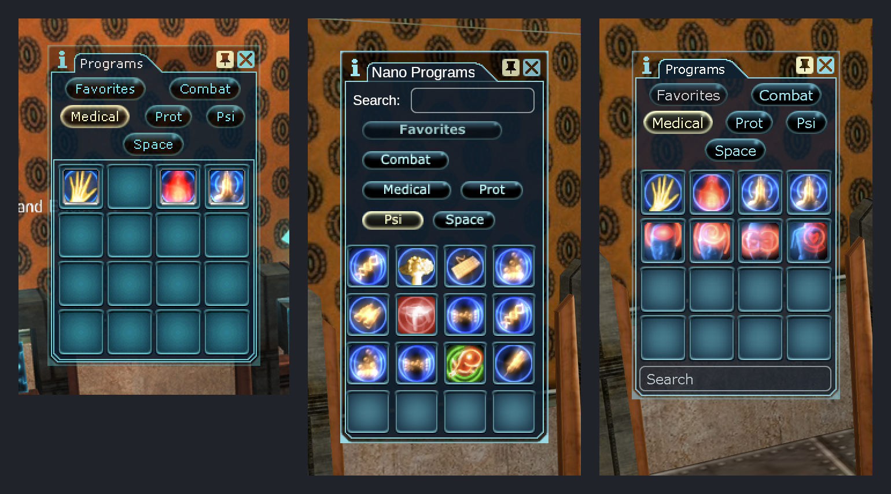
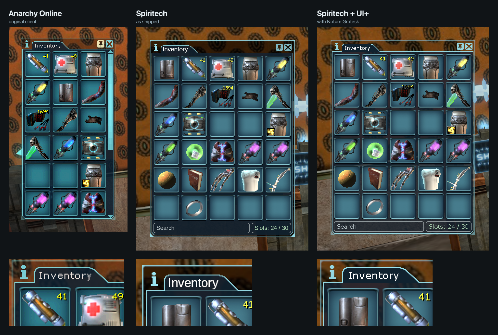

# duramson UI+ for Spiritech

Spiritech, Project Rubi-Ka's new client, brings Anarchy Online to today's computers. UI+ brings back the look of
the original client's interface: window frames built to its measurements, windows laid out as it laid them out,
and its crisp pixel text. It fixes flaws in Spiritech's bundled UI on the way, and adds a few things of its own.

**[Install](#install)** · **[Progress](#progress)** · **[What you get](#what-you-get)** ·
**[Changelog](CHANGELOG.md)** · **[Every change in pictures](docs/changes.md)**

UI+ 0.1.0 · made for Spiritech client 0.2.1 · Windows, macOS, Linux

## Progress

One part at a time gets the original client's look. 100 % means its first pass is done, not that it's finished
for good.

| Part | First pass | Status |
| --- | --- | --- |
| Window frame | `▰▰▰▰▰▰▰▰▰▰` 100 % | Done |
| Nano Programs | `▰▰▰▰▰▰▰▰▰▰` 100 % | Done |
| NCU | `▰▰▰▰▰▰▰▰▰▰` 100 % | Done |
| Scroll bar | `▰▰▰▰▰▰▰▰▱▱` 80 % | In three windows so far |
| Inventory | `▰▰▰▱▱▱▱▱▱▱` 30 % | **In progress** |
| Wear | `▱▱▱▱▱▱▱▱▱▱` 0 % | Next |

Still to come:

- **Inventory:** the rest of the window. Its search, slot count and full rows are done.
- **Scroll bar:** the other windows' lists, and a less stretched bar picture.
- **Wear:** after the Inventory. Its tab labels come out too wide with Notum Grotesk ("Imp" for "Impl").
- **Nano Programs:** a second round for the list view.
- **Item tooltips** in the inventory, bags, bank, Wear and Trade windows still show at once: the client draws them
  itself.
- **Notum Grotesk** in the Windows installer.

What is known and open is in the [issues](https://github.com/duramson/spiritech-ui-plus/issues).

## What you get

These show by themselves from the next character login:

| Part | What changes |
| --- | --- |
| **Window frame** | Every window's frame, title tab, icon, pin and close button at the original client's sizes, distances and opacity. |
| **NCU** | Slots, their spacing and the margins as in the original client's NCU window. |
| **Tooltips** | They wait until the pointer has rested for a second and a half, instead of popping up the moment it passes. |
| **Scroll bar** | The original client's scroll bar, from its own pictures, in the NCU, Nano Programs and Inventory windows. |

These are switched on once, in Options → Interface & HUD → UI packages; then log the character in again:

- **Inventory containers** → `External [duramson.inventory] — UI+` 
  The inventory, bags and banks with the search and the slot count in frames, and only sizes whose rows are all
  full.
- **Nano Programs** → `External [duramson.nano] — UI+` 
  School buttons, tiles and search as the original client draws them, or a new School Tabs layout. The window's
  menu (the i icon) switches between the two.

And the interface font, [Notum Grotesk](#notum-grotesk): the original client's pixel text.

**[Every change in pictures](docs/changes.md)**, beside the original client and Spiritech as shipped.

## Install

1. **Download** this repository (Code → Download ZIP) and unpack it anywhere.
2. **Start the installer** and press Enter to install:

   - **Windows:** double-click `install.bat`. If Windows warns about a script from the internet, choose
     More info → Run anyway.
   - **macOS:** open Terminal (⌘ Space, type `Terminal`, Enter). Type `python3` and a space, drag `install.py`
     from the unpacked folder into the Terminal window, and press Enter. If macOS offers to install its command
     line developer tools for `python3`, let it, then do it again.
   - **Linux:** the same in a terminal: `python3`, a space, the path to `install.py`.

3. **Log in a character** and switch on what you want, as listed under [What you get](#what-you-get). The window
   frame changes by itself.

The installer finds the game in the usual places; if it doesn't, it asks for the client folder (the one with
`PRK.Client` in it), and you can drag the folder into its window. `install.py` also asks whether to generate
Notum Grotesk; the first time it fetches two Python packages for that, about 20 MB.

> [!IMPORTANT]
> **Uninstall before the launcher updates the game** (2 in the installer's menu), and install again after the
> update. The launcher patches the client's own files and expects them unchanged.

- **To update UI+**, download the new version and install it; it replaces the old one.
- **To remove UI+**, uninstall. The client's own files come back from the copies the installer kept.

## Notum Grotesk

UI+'s own font: a modern, scalable take on the pixelated Verdana the original client draws its interface with.
Spiritech draws its text smoothed; Notum Grotesk brings the pixels back, at any size. Verdana belongs to Microsoft,
so the installer builds the font on your computer, from the Verdana that is already there.

1. Say yes when the installer asks to generate it (only `install.py` so far).
2. In Options, type "font" into the search and pick the interface font:
   - **Notum Grotesk** on a normal screen (100 % scaling),
   - **Notum Grotesk 200** on a Retina screen or at 200 % scaling.

[How it is made, and what is still being worked on](docs/notum-grotesk.md)

## More

- [Changelog](CHANGELOG.md): what changed, the newest first.
- [Every change in pictures](docs/changes.md): each window beside the original client and Spiritech as shipped.
- [How it works](docs/how-it-works.md): UI+ ships patches, none of Project Rubi-Ka's files.
- [Contributing](CONTRIBUTING.md): how to change something, and the rules for branches and pull requests.

## License

UI+'s own work (the patches, the installers, the tools, the documentation and its pictures) is licensed under
[CC BY-NC-SA 4.0](LICENSE): share and change it freely, name duramson UI+ as its source, keep the same license,
and don't sell it or use it commercially without permission.

Anarchy Online is a trademark of Funcom. Project Rubi-Ka and Spiritech belong to their owners, and the files
the patches apply to are theirs. This is an unofficial fan project, not made or endorsed by either.
