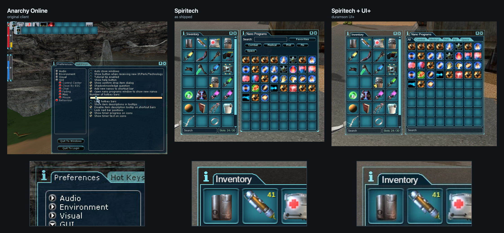

# Changes, in pictures

What this repository changes in Spiritech's UI, shown beside the original client and Spiritech as shipped. Each
section lists the commits that make the change, in the patches against Project Rubi-Ka's files.

## Window frame

Every window. The outer frame was drawn almost opaque (85 %) and read as a second bright line beside the inner frame;
it is now about as faint as the original client's (40 %, measured against it), so the world shows through behind the
title again. The title tab is opaque, so no line shows through under it, and the title sits in its tab as in the
original. The zooms show each window's top-left corner at three times its size.

- [d6c52ca](https://github.com/duramson/spiritech-ui-plus/commit/d6c52ca) fix(core): draw the window title tab opaque
- [0e31786](https://github.com/duramson/spiritech-ui-plus/commit/0e31786) fix(core): draw the outer window frame as
  faintly as the original client
- [eec59bb](https://github.com/duramson/spiritech-ui-plus/commit/eec59bb) fix(core): set the window title further into
  its tab
- [2955696](https://github.com/duramson/spiritech-ui-plus/commit/2955696) fix(core): lower the window title by a pixel
  in its tab

## Nano Programs: school tabs

A second layout for the window, picked in its menu (the i icon, School Tabs). The schools are tabs over a tab frame,
built like the Wear window's, each as wide as its label; the search sits under the frame as in the Inventory window;
the tab frame stands clear of the window's own frame, and the tiles stand 4 pixels clear of the tab frame on every
side.

- [fa29de2](https://github.com/duramson/spiritech-ui-plus/commit/fa29de2) feat(nano-programs): show the school filters
  as tabs, as in the Wear window
- [aa3a050](https://github.com/duramson/spiritech-ui-plus/commit/aa3a050) feat(nano-programs): move the search under
  the tab frame, as in the Inventory window
- [24a499b](https://github.com/duramson/spiritech-ui-plus/commit/24a499b) fix(nano-programs): keep the tab frame clear
  of the window's inner frame
- [25b960c](https://github.com/duramson/spiritech-ui-plus/commit/25b960c) feat(nano-programs): switch between the tabs
  and the bundled layout in the window menu
- [b0229da](https://github.com/duramson/spiritech-ui-plus/commit/b0229da) fix(nano-programs): space the grid's tiles
  evenly inside the tab frame
- [6b7098e](https://github.com/duramson/spiritech-ui-plus/commit/6b7098e) fix(nano-programs): set the tab labels
  further into their tabs

## Nano Programs: the bundled layout

The window's own layout, brought closer to the original client. The school buttons are plain buttons, as the original
draws them: each as wide as its label and about 10 pixels more on either side, each row's free width shared equally
around its buttons (a lone one centred), at the original's distances from the frame, from each other and from the
list (they were pictures with the label baked in, at fixed widths, packed to the left). The search sits under the grid as in the Inventory window, and the
tiles stand 4 pixels clear of the frame on both sides, where they stood 3 pixels from the left and 8 from the right.

- [bd61407](https://github.com/duramson/spiritech-ui-plus/commit/bd61407) fix(nano-programs): space the grid's tiles
  evenly in the bundled layout too
- [be7c9e7](https://github.com/duramson/spiritech-ui-plus/commit/be7c9e7) feat(nano-programs): move the bundled
  layout's search under the list, as in the Inventory window
- [b366aab](https://github.com/duramson/spiritech-ui-plus/commit/b366aab) fix(nano-programs): draw the school buttons
  as the original client does
