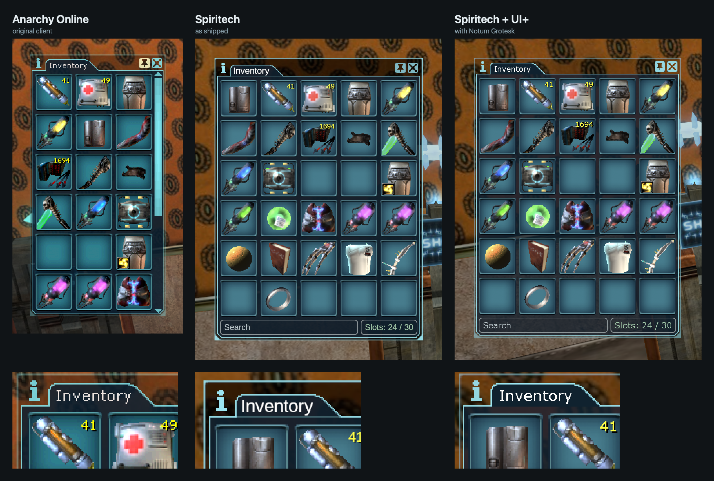
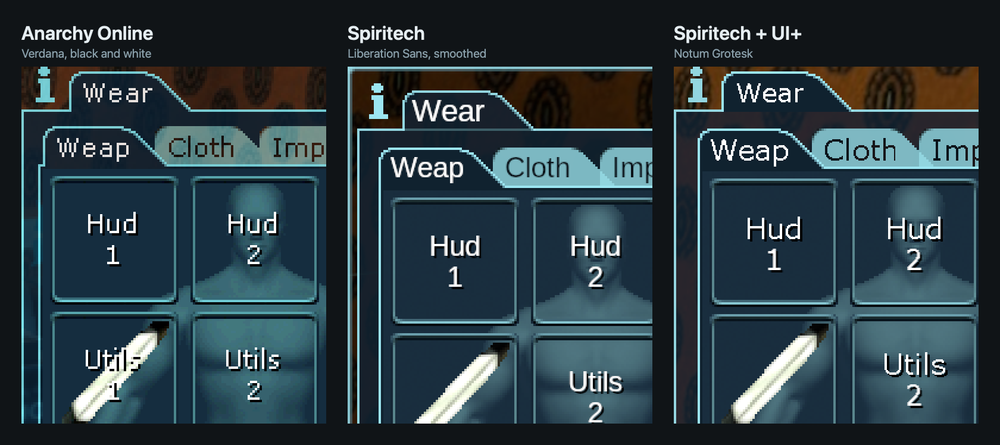
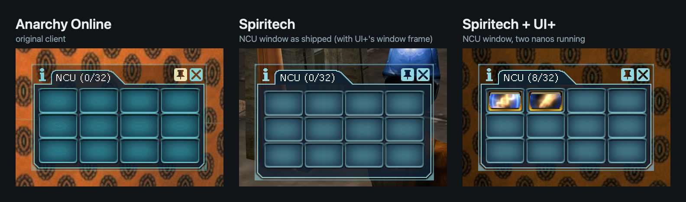
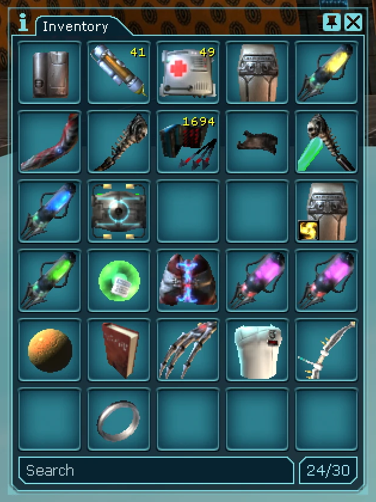
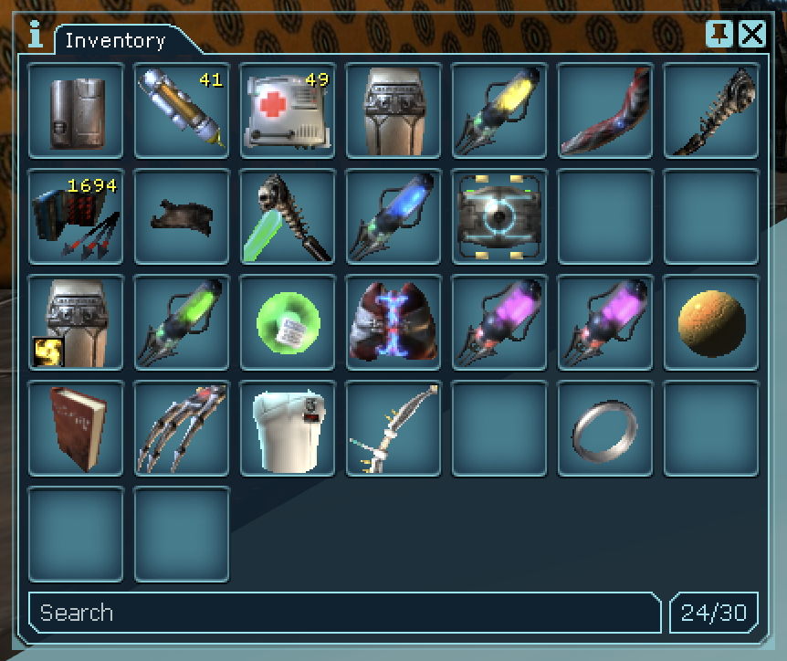
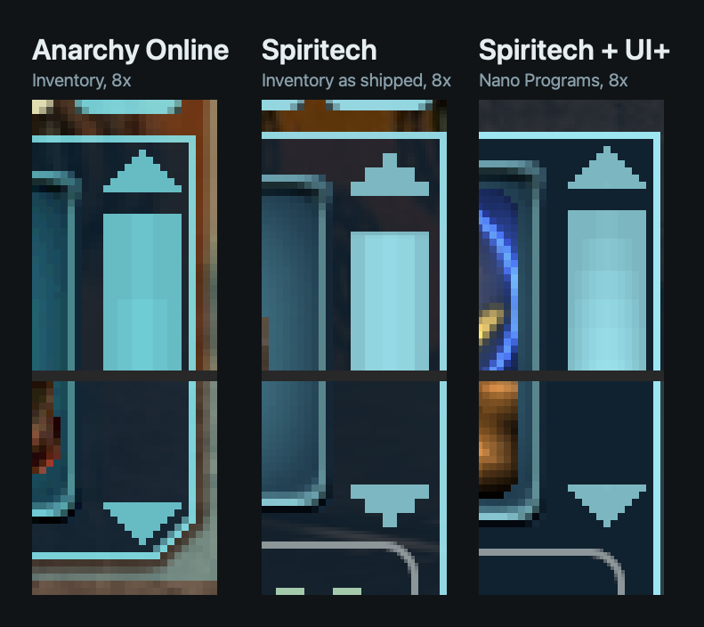

# Changes, in pictures

What UI+ changes in Spiritech's UI. Each picture shows the original Anarchy Online client on the left, Spiritech 0.1.0
as shipped in the middle and Spiritech with UI+ on the right, all at the same spot in Ithaca on the same Mac. The
original client ran with [ao-vk](https://github.com/wannabuh/ao-vk) at 1920×1080; its pictures are doubled pixel for
pixel to match Spiritech's Retina pictures. The text in the UI+ pictures is Notum Grotesk (see below). Each section
lists the commits that make the change.

## Window frame and text

Every window. The frame and title bar follow the original client's measurements, taken from pictures of its windows
over a black and a white background: the outer frame is 3 pixels wide at 33 % (Spiritech draws 4 pixels at 85 %), the
line under the title sits 23 pixels below the top edge, the title tab starts 7 pixels down and is drawn opaque, and
the window icon, pin and close button stand 5 pixels below the top edge at 85 %. The title is set at 11 pixels, the
original's size. Each window's content keeps its size, so windows come out 2 pixels narrower and 4 shorter. The zooms
under the windows show their top-left corners at four times their size.

The installer offers Notum Grotesk, the original client's interface text: Verdana in black-and-white pixels, built on
the player's computer from the Verdana already there (nothing made from Verdana is in this repository). Picked as the
interface font, it draws Spiritech's text in crisp pixels instead of soft antialiased type. On a Retina screen or at
200 % display scaling Spiritech draws text at twice the resolution, so the pixels come out much finer than the
original client's (as in these pictures, taken on a Retina Mac). For those screens the installer also builds Notum
Grotesk 200, which draws each of the font's pixels as 2 × 2; both are still being worked on. At 100 % plain Notum
Grotesk should give the original's pixels; that is untested so far.

- [d6c52ca](https://github.com/duramson/spiritech-ui-plus/commit/d6c52ca) fix(core): draw the window title tab opaque
- [0e31786](https://github.com/duramson/spiritech-ui-plus/commit/0e31786) fix(core): draw the outer window frame as
  faintly as the original client
- [eec59bb](https://github.com/duramson/spiritech-ui-plus/commit/eec59bb) fix(core): set the window title further into
  its tab
- [2955696](https://github.com/duramson/spiritech-ui-plus/commit/2955696) fix(core): lower the window title by a pixel
  in its tab
- [dd68578](https://github.com/duramson/spiritech-ui-plus/commit/dd68578) fix(core): build the window frame and title
  bar to the original client's measurements
- [b6fbd31](https://github.com/duramson/spiritech-ui-plus/commit/b6fbd31) feat(fonts): build Notum Grotesk, the
  original client's pixel text, from the player's Verdana
- [30d9e51](https://github.com/duramson/spiritech-ui-plus/commit/30d9e51) feat: offer Notum Grotesk while installing
- [265f4f1](https://github.com/duramson/spiritech-ui-plus/commit/265f4f1) feat(fonts): add Notum Grotesk 200, the
  original pixels doubled for Retina and 200 % scaling
- [a80993c](https://github.com/duramson/spiritech-ui-plus/commit/a80993c) feat: install Notum Grotesk 200 alongside
  Notum Grotesk
- [097dfc9](https://github.com/duramson/spiritech-ui-plus/commit/097dfc9) fix(core): fit the window frame patch to
  client 0.2.0
- [00e2dac](https://github.com/duramson/spiritech-ui-plus/commit/00e2dac) fix(core): keep a docked window's content
  as tall as when it floated
- [852f4fb](https://github.com/duramson/spiritech-ui-plus/commit/852f4fb) fix(fonts): close the wide gap after "m" in
  Spiritech's chat

## Nano Programs: the bundled layout

UI+ replaces the Nano Programs window (Options > Interface & HUD > UI packages, "duramson.nano"); its own layout is
brought close to the original client's. The window is called "Programs" as there. The school buttons are plain
buttons drawn as the original draws them: each as wide as its label and about 10 pixels more on either side, each
row's free width shared equally around its buttons, a lone one centred (Spiritech shows pictures with the label baked
in, at fixed widths, packed to the left). Under the buttons the list and the grid sit in a second frame, as in the
original client: its line one pixel clear of the window's frame at the sides and the bottom and 4 pixels under the
buttons, the tab background inside it a little darker and bluer than the window's. The search sits in that frame
under the grid, lined up with the tiles, as far from the frame on the left as on the right (it used to stand half a
pixel closer to it on the left). The tiles show the slot picture at 40 pixels, 2 apart, with the icon 4 pixels in, and
stand 4 pixels clear of the frame's lines at the sides and 3 under its top. The search field has no tooltip ("Nano
name"): it only repeated what the field shows. The middle picture has Psi picked, the others Medical; the UI+ picture
uses Notum Grotesk 200.

- [2a45fd6](https://github.com/duramson/spiritech-ui-plus/commit/2a45fd6) feat(nano-programs): offer the copy as a
  replacement for the bundled window
- [9941c78](https://github.com/duramson/spiritech-ui-plus/commit/9941c78) fix(nano-programs): shorten its entry in the
  UI package list
- [bd61407](https://github.com/duramson/spiritech-ui-plus/commit/bd61407) fix(nano-programs): space the grid's tiles
  evenly in the bundled layout too
- [be7c9e7](https://github.com/duramson/spiritech-ui-plus/commit/be7c9e7) feat(nano-programs): move the bundled
  layout's search under the list, as in the Inventory window
- [b366aab](https://github.com/duramson/spiritech-ui-plus/commit/b366aab) fix(nano-programs): draw the school buttons
  as the original client does
- [24250e8](https://github.com/duramson/spiritech-ui-plus/commit/24250e8) fix(nano-programs): draw the tiles and the
  title as the original client does
- [7ddbe9f](https://github.com/duramson/spiritech-ui-plus/commit/7ddbe9f) fix(nano-programs): frame the bundled
  layout's grid as the original client does
- [dc62d56](https://github.com/duramson/spiritech-ui-plus/commit/dc62d56) fix(nano-programs): drop the search field's
  tooltip

## Nano Programs: school tabs

A second layout, picked in the window's menu (the i icon, School Tabs); the original client has none like it. The
schools are tabs over a tab frame, built like the Wear window's, each as wide as its label. The search sits under the
frame as in the Inventory window, the tab frame stands clear of the window's own frame, and the tiles stand 4 pixels
clear of the tab frame on every side. The picture shows Spiritech as shipped and the School Tabs layout.

- [fa29de2](https://github.com/duramson/spiritech-ui-plus/commit/fa29de2) feat(nano-programs): show the school filters
  as tabs, as in the Wear window
- [aa3a050](https://github.com/duramson/spiritech-ui-plus/commit/aa3a050) feat(nano-programs): move the search under
  the tab frame, as in the Inventory window
- [24a499b](https://github.com/duramson/spiritech-ui-plus/commit/24a499b) fix(nano-programs): keep the tab frame clear
  of the window's inner frame
- [25b960c](https://github.com/duramson/spiritech-ui-plus/commit/25b960c) feat(nano-programs): switch between the tabs
  and the bundled layout in the window menu
- [b0229da](https://github.com/duramson/spiritech-ui-plus/commit/b0229da) fix(nano-programs): space the grid's tiles
  evenly inside the tab frame
- [6b7098e](https://github.com/duramson/spiritech-ui-plus/commit/6b7098e) fix(nano-programs): set the tab labels
  further into their tabs

## NCU window

The NCU window, and the target's NCU window in grid mode, which is built from the same files. The slots stand 47
pixels apart across with a pixel of background between them, and 29 down, each row covering the dark bottom line of
the slot above, as in the original client; Spiritech sets them 46 by 30 apart. They stand 4 pixels clear of the
window's frame lines on every side, where Spiritech leaves 6 to 10, so a window of 4 by 3 slots comes out 203 by 124
pixels instead of 207 by 135. The middle picture was taken with UI+'s window frame already on; the window's content is
as shipped. The original client's picture has no nano running.

- [13f0e81](https://github.com/duramson/spiritech-ui-plus/commit/13f0e81) fix(core): build the NCU window to the
  original client's measurements

## Inventory: search and slot count

UI+ replaces the Inventory window (Options > Interface & HUD > UI packages, "duramson.inventory"), the one package the
client draws the inventory, bags, banks and loot with. It takes out what got in the way: the tooltips on the search
field ("Item name, at least three letters, then Enter") and on the slot count ("Slots holding an item, of all slots")
only repeated what they show, and the search's opened right over the slot count and ran far past the window's edge.

The search and the count were Spiritech's grey, rounded input fields. Now each sits in a frame like the Nano Programs
window's second frame, in the tab frame's blue line on its dark background, and the two mirror each other: the
search's bottom-left corner is cut as the window's, the count's bottom-right one, and their cut top corners meet in a
notch between them. Their lines stand 5 pixels clear of the window's side and bottom lines, in line with the slots'
outlines, and run on under the scroll bar where it shows, as the Nano window's search does. The count reads "24/30"
in the blue of the NCU count in the corner of the screen, its digits 6 pixels from every line; typed text in the search
takes the same blue. The window's dark background now reaches under the two frames as well. The scroll bar is the
original client's (see Scroll bar below).

- [15d653f](https://github.com/duramson/spiritech-ui-plus/commit/15d653f) feat(inventory): offer an Inventory window
  without the search and slot tooltips
- [29c8fa3](https://github.com/duramson/spiritech-ui-plus/commit/29c8fa3) fix(inventory): draw the dark background
  under the search and the slot count too
- [94c18e8](https://github.com/duramson/spiritech-ui-plus/commit/94c18e8) feat(inventory): frame the search and the
  slot count like the Nano window's second frame

## Inventory: full rows

Resized, the Inventory window takes only sizes whose rows are all full. Spiritech's takes any number of columns and as
many rows as the slots need, so most widths left the last row short: with 30 slots, 7 across gave four full rows and
two slots in a fifth, 4 across two slots in the eighth. Now the columns always divide the slots (for 30: 1, 2, 3, 5,
6, 10, 15 or 30 across), with or without the scroll bar. The bank keeps its smallest size of 6 by 4 with credits. The
picture shows the short row as it was, in UI+'s Inventory, which sized its grid as Spiritech's does.

- [7090d98](https://github.com/duramson/spiritech-ui-plus/commit/7090d98) fix(inventory): fill every row when the
  window is resized

## Scroll bar

The scroll bar of the NCU window, the Nano Programs grid and the Inventory window. Spiritech draws its own: arrows in
three steps, 2 pixels under the frame's line and 5 from the bar. UI+ puts the original client's in its place, built
from its own pictures (GFX_GUI_SIMPLE_SB_*, which Spiritech has too): the arrows are smooth triangles 11 pixels wide
and 6 high, a pixel under the frame's line and a pixel clear of the line on the right, 3 pixels from the bar. The arrows
scroll a row and repeat while held, a press above or below the bar pages that way, and the bar can be dragged. The bar
picture is stretched to its length, a little softer than in the original client. In the Inventory the bar stands 4
pixels clear of the slots, as there, and the grid gives up the bar's width only while the bar shows. The picture shows
the Inventory window in all three.

- [06dd9a8](https://github.com/duramson/spiritech-ui-plus/commit/06dd9a8) feat(core): add the original client's scroll
  bar, from its own pictures
- [672cc84](https://github.com/duramson/spiritech-ui-plus/commit/672cc84) fix(core): give the NCU window the original
  client's scroll bar
- [aead52d](https://github.com/duramson/spiritech-ui-plus/commit/aead52d) fix(nano-programs): give the grid the
  original client's scroll bar
- [3e4521f](https://github.com/duramson/spiritech-ui-plus/commit/3e4521f) fix(inventory): give the grid the original
  client's scroll bar

## Tooltips

The shortcut bars and most windows. Spiritech shows a tooltip the moment the pointer touches a button, a slot or a bar,
so sweeping the pointer over the shortcut bars pops one up after another. The original client waited until the pointer
had rested on a button for about a second. Spiritech has no such delay of its own, so UI+ adds one in Core, which every
window package loads: a tooltip set from Lua shows only once the pointer has rested on its button for a second and a
half, and sweeping over the bars shows none. That covers the shortcut bars (the client draws their descriptions, but Lua
switches them on and off), the grids and lists of the Actions, NCU and Nano Programs windows, the health and nano bars
and the target panels. A delay shows in no picture, so this section has none.

The client draws the item tooltips in the inventory, bags, bank, Wear and Trade windows itself, and Lua can hold them
back only by unbinding the item, which would also stop clicks and drags; those still show at once. So do the tooltips
a layout file sets directly and those of the client's own windows, such as Options.

- [6a2372d](https://github.com/duramson/spiritech-ui-plus/commit/6a2372d) feat(core): show tooltips only once the
  pointer rests on them

## Not done yet

- **Item tooltips.** The inventory, bags, bank, Wear and Trade windows still show item tooltips at once: the client
  draws them itself, and Lua can't make them wait (see Tooltips above).

- **Wear.** Its tab labels are set at 12 pixels where the original client draws 11, so with Notum Grotesk "Impl" is
  cut to "Imp". ("Socia" is cut in the original client too.)
