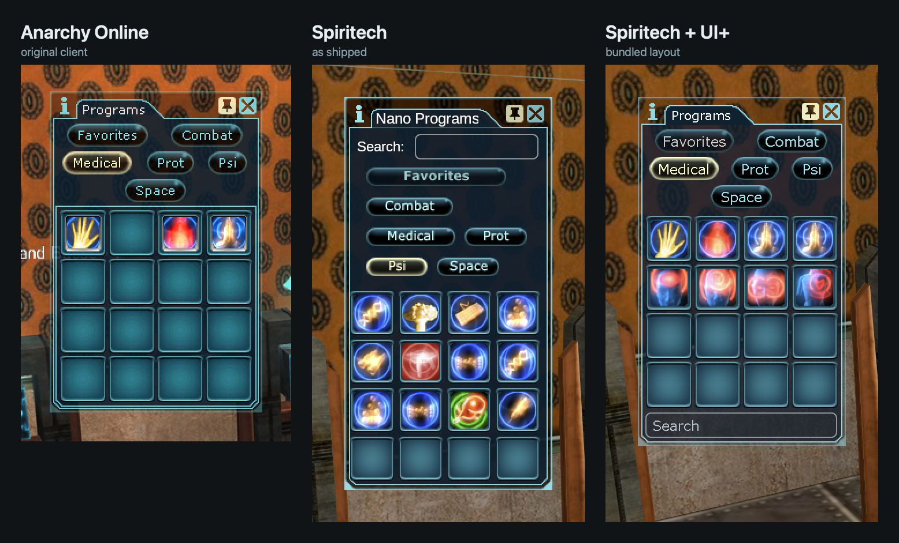
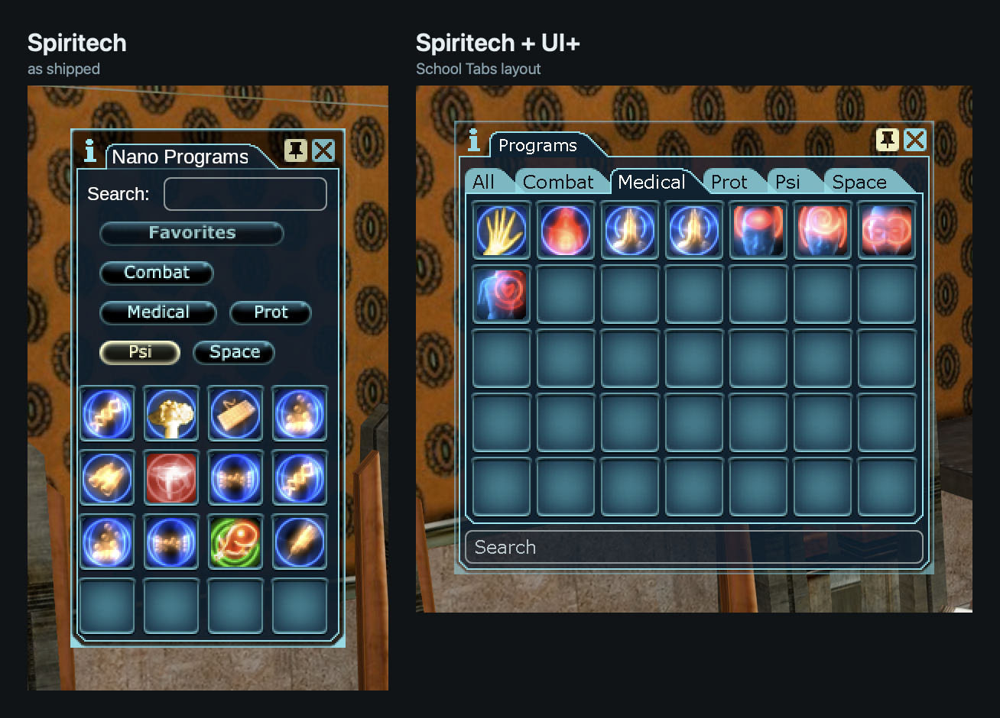

# Changes, in pictures

What UI+ changes in Spiritech's UI. Each picture shows the original Anarchy Online client on the left, Spiritech 0.1.0
as shipped in the middle and Spiritech with UI+ on the right, all at the same spot in Ithaca on the same Mac. The
original client ran with [ao-vk](https://github.com/wannabuh/ao-vk) at 1920×1080; its pictures are doubled pixel for
pixel to match Spiritech's Retina pictures. The text in the UI+ pictures is Notum Grotesk (see below). Each section
lists the commits that make the change.

## Window frame and text

Every window. The frame and title bar follow the original client's measurements, taken from pictures of its windows
over a black and a white background: the outer frame is 3 pixels wide at 33 % (Spiritech draws 4 pixels at 85 %), the
line under the title sits 23 pixels below the top edge, the title tab starts 7 pixels down and is drawn opaque, and
the window icon, pin and close button stand 5 pixels below the top edge at 85 %. The title is set at 11 pixels, the
original's size. Each window's content keeps its size, so windows come out 2 pixels narrower and 4 shorter. The zooms
under the windows show their top-left corners at four times their size.

The installer offers Notum Grotesk, the original client's interface text: Verdana in black-and-white pixels, built on
the player's computer from the Verdana already there (nothing made from Verdana is in this repository). Picked as the
interface font, it draws Spiritech's text in crisp pixels instead of soft antialiased type. Still being worked on:
on a Retina screen or at 200 % display scaling Spiritech draws text at twice the resolution, so the pixels come out
much finer than the original client's (as in these pictures, taken on a Retina Mac). At 100 % they should be the
original's; that is untested so far.

- [d6c52ca](https://github.com/duramson/spiritech-ui-plus/commit/d6c52ca) fix(core): draw the window title tab opaque
- [0e31786](https://github.com/duramson/spiritech-ui-plus/commit/0e31786) fix(core): draw the outer window frame as
  faintly as the original client
- [eec59bb](https://github.com/duramson/spiritech-ui-plus/commit/eec59bb) fix(core): set the window title further into
  its tab
- [2955696](https://github.com/duramson/spiritech-ui-plus/commit/2955696) fix(core): lower the window title by a pixel
  in its tab
- [dd68578](https://github.com/duramson/spiritech-ui-plus/commit/dd68578) fix(core): build the window frame and title
  bar to the original client's measurements
- [b6fbd31](https://github.com/duramson/spiritech-ui-plus/commit/b6fbd31) feat(fonts): build Notum Grotesk, the
  original client's pixel text, from the player's Verdana
- [30d9e51](https://github.com/duramson/spiritech-ui-plus/commit/30d9e51) feat: offer Notum Grotesk while installing

## Nano Programs: the bundled layout

UI+ replaces the Nano Programs window (Options > Interface & HUD > UI packages, "duramson.nano"); its own layout is
brought close to the original client's. The window is called "Programs" as there. The school buttons are plain
buttons drawn as the original draws them: each as wide as its label and about 10 pixels more on either side, each
row's free width shared equally around its buttons, a lone one centred (Spiritech shows pictures with the label baked
in, at fixed widths, packed to the left). The search sits under the grid as in the Inventory window. The tiles show
the slot picture at 40 pixels, 2 apart, with the icon 4 pixels in, and stand 4 pixels clear of the frame on both
sides. The middle picture has Psi picked, the others Medical.

- [2a45fd6](https://github.com/duramson/spiritech-ui-plus/commit/2a45fd6) feat(nano-programs): offer the copy as a
  replacement for the bundled window
- [9941c78](https://github.com/duramson/spiritech-ui-plus/commit/9941c78) fix(nano-programs): shorten its entry in the
  UI package list
- [bd61407](https://github.com/duramson/spiritech-ui-plus/commit/bd61407) fix(nano-programs): space the grid's tiles
  evenly in the bundled layout too
- [be7c9e7](https://github.com/duramson/spiritech-ui-plus/commit/be7c9e7) feat(nano-programs): move the bundled
  layout's search under the list, as in the Inventory window
- [b366aab](https://github.com/duramson/spiritech-ui-plus/commit/b366aab) fix(nano-programs): draw the school buttons
  as the original client does
- [24250e8](https://github.com/duramson/spiritech-ui-plus/commit/24250e8) fix(nano-programs): draw the tiles and the
  title as the original client does

## Nano Programs: school tabs

A second layout, picked in the window's menu (the i icon, School Tabs); the original client has none like it. The
schools are tabs over a tab frame, built like the Wear window's, each as wide as its label. The search sits under the
frame as in the Inventory window, the tab frame stands clear of the window's own frame, and the tiles stand 4 pixels
clear of the tab frame on every side. The picture shows Spiritech as shipped and the School Tabs layout.

- [fa29de2](https://github.com/duramson/spiritech-ui-plus/commit/fa29de2) feat(nano-programs): show the school filters
  as tabs, as in the Wear window
- [aa3a050](https://github.com/duramson/spiritech-ui-plus/commit/aa3a050) feat(nano-programs): move the search under
  the tab frame, as in the Inventory window
- [24a499b](https://github.com/duramson/spiritech-ui-plus/commit/24a499b) fix(nano-programs): keep the tab frame clear
  of the window's inner frame
- [25b960c](https://github.com/duramson/spiritech-ui-plus/commit/25b960c) feat(nano-programs): switch between the tabs
  and the bundled layout in the window menu
- [b0229da](https://github.com/duramson/spiritech-ui-plus/commit/b0229da) fix(nano-programs): space the grid's tiles
  evenly inside the tab frame
- [6b7098e](https://github.com/duramson/spiritech-ui-plus/commit/6b7098e) fix(nano-programs): set the tab labels
  further into their tabs

## Not done yet

- **Wear.** Its tab labels are set at 12 pixels where the original client draws 11, so with Notum Grotesk "Impl" is
  cut to "Imp". ("Socia" is cut in the original client too.)
