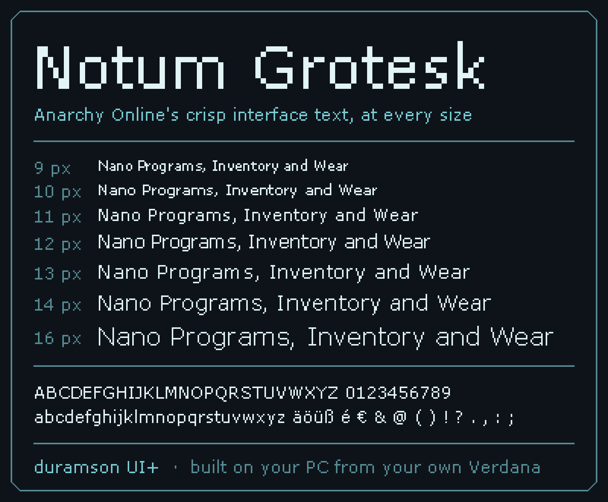
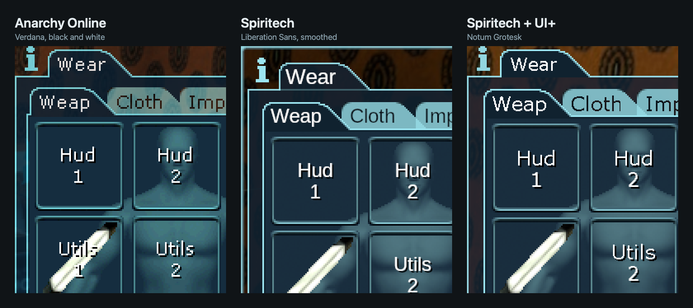

# Notum Grotesk

Notum Grotesk is UI+'s own font: a modern, scalable take on the pixelated Verdana the original client draws its
interface with. That client sets its text in Verdana, hinted and in black and white, so every letter is sharp
pixels. Spiritech draws its text smoothed, so even Verdana comes out softer and thicker there. Notum Grotesk brings
the pixels back, at any size.

## Setup

1. Say yes when the installer asks to generate it (only `install.py` so far; the first time it fetches two Python
   packages for that, about 20 MB).
2. In Options, type "font" into the search and pick Notum Grotesk as the interface font, or Notum Grotesk 200 on a
   Retina screen or at 200 % scaling.

## Built from your Verdana

Verdana belongs to Microsoft, so a font made from it can't be shipped. Instead the installer builds the font on your
computer, from the Verdana that is already there: it draws every letter the way the original client
does, at every size from 6 to 72 pixels, and packs all those pixel sets into one TrueType font. The font's own
hinting program picks the right set for the size Spiritech asks for, so the text stays pixel-sharp at any font size
and interface scale. Nothing made from Verdana is in this repository; `fonts/ao-pixels.json` holds only checksums of
the original client's letters, to tell whether a Verdana gives the same pixels (macOS's gives all 610 at 11 px).

## Notum Grotesk 200

On a Retina screen, or with Windows' display scaling at 200 %, Spiritech draws text at twice the resolution, so
Notum Grotesk's pixels come out half as big: sharp, but much finer than the original client's text. For those screens
the installer builds a second font beside it, Notum Grotesk 200, which draws each pixel as 2 × 2 so the letters come
out at the original client's size, as in the picture above (taken on a Retina Mac); pick it instead.

## The names over the heads

The names over the heads take the same pixels. Spiritech writes them with a font of its own that no package can
change, so the font file can't help there: the installer writes Notum Grotesk's 13 px pixels into a table beside it,
and UI+'s nameplates draw each run of them as a small rectangle, a pixel further apart than in the windows, as the
original client does. The interface font doesn't matter for them.
The [picture page](changes.md#overhead-nameplates) shows them beside the original's.

## Open

Both fonts are still being worked on. At a normal resolution (100 % scaling) plain Notum Grotesk's pixels should be
the original client's; that hasn't been tested yet, because UI+ is made on a Mac. Pictures from such a screen are
welcome.
